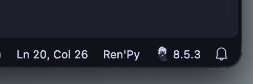
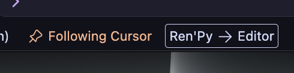
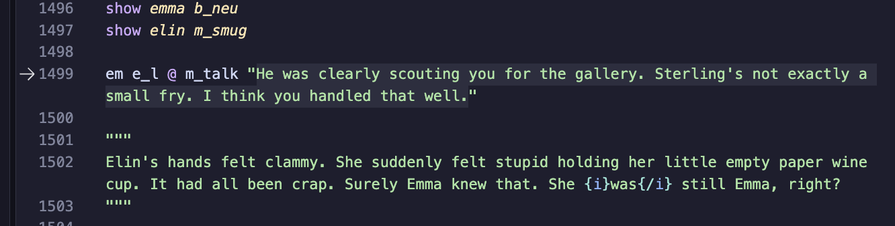

# Ren'Py Launch and Sync user manual

This is a manual intended for users of the extension. It will also contain some
technical information for those curious.

This manual doesn't list every command and setting. For the full reference,
including keybinds, open the extension's _Feature Contributions_ tab in Visual
Studio Code.

Ren'Py Launch and Sync is maintained by furudean (meri p).

## Version support

Ren'Py 8.3+ supports all features.

On Ren'Py 8.2 and earlier, current line features can't understand `{w}`/`{p}`
and instead show the full line.

Ren'Py 8.0 and earlier does not support .rpe features at all.

Ren'Py 7.x versions may work, but no support will be provided.

## Recommended workflow

### Initial setup

1. Open the _Run and Debug_ menu
2. Create a launch.json file (if none exists)
3. Select _Renpy Launch and Sync_ as the debugger type. This should fill your
   launch.json with a basic debugger configuration.
4. Start debugging
5. You should be prompted to select an SDK version to use. If unsure, just
   select latest. This will write a file called .renpy-version into your
   workspace.
6. You will be asked if downloading this SDK version is okay. Choose _Download_
   to proceed. The SDK will be downloaded to Visual Studio Code's data
   directory.
7. You will be asked if [Ren'Py extensions](#renpy-extension-rperpepy) should be
   installed in the project. Most features, like _Follow Cursor_, warping in
   place, and stepping, depend on them. This choice is stored in the
   `renpyWarp.renpyExtensionsEnabled` setting.

The game should have been started. Setup is complete.

### After setup

You start the game through the debugger configuration you created.

When the game is running, march through the dialogue and watch the editor
decorations change per line to quickly find where you are. You can use [_Follow
Cursor_](#follow-cursor) if you want a side-by-side view.

You can [warp to a specific line](#warping) with the warping feature.

You may also want to use the [debugger's features](#debugging), like the _Debug
Console_ and stepping.

## Debugging

As of v5.0.0, starting and stopping a game is done through Visual Studio Code's
built-in debugger. Commonly this is triggered through the _Run and Debug_ view,
or with <kbd>F5</kbd> when a .rpy file is open.

Most features require a version of at least Ren'Py 8.1.

### Debug configurations

When you start debugging, the extension will try and find a launch
configuration. If none is found in the workspace, a default configuration will
be used. You can add your own to `.vscode/launch.json` to make the debugger
available to other people working on your project.

Here is an example:

```jsonc
{
	"version": "0.2.0",
	"configurations": [
		{
			"type": "renpyWarp",
			"request": "launch",
			"name": "Launch Ren'Py project",
			// all properties below optional - remove if unwanted
			"project": "path/to/project", // detected or prompted for if not specified (may be relative)
			"file": "script.rpy", // script to warp to on launch (useful with ${file})
			"line": 11, // line in `file` to warp to (useful with `${lineNumber}`). defaults to the first playable statement in `file`
			"args": [], // CLI arguments to pass to renpy
			"env": {}, // environment variables to pass to renpy
			"sdk": "8.3.7" // sdk version to use (or path to one), taking precedence over .renpy-version file
		}
	]
}
```

An `attach` configuration takes the `pid` of a game the extension is already
tracking. You rarely need one, since connected games get a session
automatically.

### Console

Per-process output is shown in the _Debug Console_ while a game is running. You
can also use this to send console messages, similar to
<kbd>Ctrl</kbd>+<kbd>O</kbd> inside Ren'Py.

### Stepping

While a game is connected, you can use the debug toolbar to move through
dialogue.

The step buttons are disabled while Ren'Py is in its own menus, such as the main
menu or the preferences screen.

### External processes

Games started outside of Visual Studio Code, such as from the Ren'Py launcher,
can also connect to the extension if they have the extension's Ren'Py extensions
installed.

A connected external game gets its own debug session, so all features work the
same as for a game launched from the extension.

## Warping

### Open Ren'Py to line

_Open Ren'Py to line_ (<kbd>Alt</kbd>+<kbd>Shift</kbd>+<kbd>E</kbd>, or
<kbd>⌘</kbd>+<kbd>Shift</kbd>+<kbd>E</kbd> on Mac) takes the game to the
statement under your cursor.

- If a game is running with Ren'Py extensions, that game warps in place.
- Otherwise, a new game is launched at that line.

Most Ren'Py statements can be warped to.

Warping relies on Ren'Py's warp feature, which has limits. See
[Troubleshooting](#troubleshooting) for more information.

### Open Ren'Py at label

_Open Ren'Py at label_ (<kbd>Alt</kbd>+<kbd>Shift</kbd>+<kbd>J</kbd>, or
<kbd>⌘</kbd>+<kbd>Shift</kbd>+<kbd>J</kbd> on Mac) lists the game's labels and
jumps to the one you pick. If no game is running, one is launched first.

The label you're currently in is marked. Labels can be starred as favorites,
which pins them to the top of the list, and reordered with the arrow buttons.

This command needs Ren'Py extensions.

### Go to current Ren'Py line

_Go to current Ren'Py line_ (<kbd>Ctrl</kbd>+<kbd>Shift</kbd>+<kbd>E</kbd>, or
<kbd>⌥</kbd>+<kbd>Shift</kbd>+<kbd>E</kbd> on Mac) goes the other way. It moves
your editor to the line the game is on. To do this continuously, use
[_Follow Cursor_](#follow-cursor).

### Open Visual Studio Code at line

In a running game, pressing <kbd>Shift</kbd>+<kbd>E</kbd> opens the current line
in Visual Studio Code. (This is a Ren'Py feature, not something added by the
extension.) The [`renpyWarp.editor`](#editor) setting decides which editor
opens.

### Others

Some commands run a Ren'Py SDK action on your project without opening the
game:

| Command                  | Action                                         |
| ------------------------ | ---------------------------------------------- |
| Lint project             | Runs Ren'Py's linter and opens the report      |
| Delete persistent data   | Clears the project's persistent data           |
| Force Recompile          | Recompiles every script                        |
| Open the Ren'Py launcher | Opens the launcher of the SDK the project uses |

## SDK management

The extension can manage versions of Ren'Py. Required versions will be
automatically downloaded (provided you give permission). They are downloaded
from https://www.renpy.org/dl/ and stored inside Visual Studio Code's data
folder.

The SDK version used is nominally decided by a .renpy-version file in your
project. This file may contain a version string or an absolute path to an SDK on
disk. If a .renpy-version file is detected in your workspace, it will be shown
in the status bar.



This status bar item can be activated to show the _Select Ren'Py SDK Version_
menu. This is just a fancy menu to select the version in the .renpy-version
file, but it can be useful to quickly select a version.

Nightly versions are also supported.

## Follow Cursor



Ren'Py Launch and Sync can keep its cursor in sync with the Ren'Py game. After it
is enabled with the status bar item, the direction can also be cycled through
by clicking on it.

_Toggle following cursor mode_ (<kbd>Alt</kbd>+<kbd>Shift</kbd>+<kbd>C</kbd>, or
<kbd>⌘</kbd>+<kbd>Shift</kbd>+<kbd>C</kbd> on Mac) turns syncing on and off.
_Cycle follow cursor direction_
(<kbd>Ctrl</kbd>+<kbd>Alt</kbd>+<kbd>Shift</kbd>+<kbd>C</kbd>, or
<kbd>⌘</kbd>+<kbd>⌥</kbd>+<kbd>Shift</kbd>+<kbd>C</kbd> on Mac) switches
between the directions below.

The directions work thusly:

<dl>
   <dt><strong>Ren'Py → Script</strong></dt>
   <dd>
      Ren'Py advancing will update the editor's cursor
   </dd>
   <dt><strong>Ren'Py ← Script</strong></dt>
   <dd>
      Moving the editor cursor will update Ren'Py's current dialogue line
   </dd>
   <dt><strong>Ren'Py ↔ Script</strong></dt>
   <dd>
      Ren'Py and editor cursor stay in sync with each other
   </dd>
</dl>

Cursor syncing can be turned on by default with the setting
`renpyWarp.followCursorOnLaunch`.

When Ren'Py moves, `renpyWarp.followCursorBehavior` decides what happens to
your cursor:

| Value                  | Behavior                                       |
| ---------------------- | ---------------------------------------------- |
| Just reveal (default)  | Scrolls to the dialogue, leaving the cursor be |
| Select dialogue        | Selects the dialogue being said                |
| Cursor at dialogue end | Places the cursor where the dialogue ends      |
| Cursor at line end     | Places the cursor at the end of the line       |

## Decorations



While a game is connected, the dialogue Ren'Py is showing is highlighted, and a
gutter icon shows the line. These can be turned off with
`renpyWarp.showDialogueDecorations` and `renpyWarp.showGutterDecorations`
respectively.

The highlight color is the
`renpyWarp.dialogueBackgroundDecoration` theme color, which can be changed with
`workbench.colorCustomizations`.

## Ren'Py extension (.rpe/.rpe.py)

The extension installs an .rpe or .rpe.py file in your project. This is a Python
file that Ren'Py will execute at startup. The source of this file can be found
at [`assets/vscode_renpy_warp.rpe.py`](../assets/vscode_renpy_warp.rpe.py).

The purpose of this file is to connect the running game to the extension over a
socket. This kind of communication is usually referred to as inter-process
communication, or IPC. This allows powerful features like _Follow Cursor_ and
the _Debug Console_ to work.

The .rpe file will not modify your game's files directly, but it will change
some environment variables and inject some Ren'Py configuration variables. They
are documented in the tables below.

On Windows, a named pipe is used for IPC. On Unix systems, a domain socket will
be used. In previous versions of the extension, a websocket was used on all
systems. This was discontinued due to security reasons. See
[Security](#security).

### Modified environment variables

Set on games launched from the extension.

| Variable                   | Value                                      |
| -------------------------- | ------------------------------------------ |
| `RENPY_EDIT_PY`            | Value of the `renpyWarp.editor` setting    |
| `RENPY_VSCODE`             | Path to the `code` or `vscodium` CLI       |
| `RENPY_SCREENSHOT_PATTERN` | `<project>/screenshot%04d.png`             |
| `RENPY_SKIP_SPLASHSCREEN`  | `1` when _Jump to label_ launches the game |
| `WARP_IPC_PATH`            | Socket or pipe the RPE connects to         |
| `WARP_IPC_NONCE`           | Identifies the game to the extension       |

The RPE also reads `WARP_LOGLEVEL` to set its log level (`INFO` by default).

### Editor

The `renpyWarp.editor` setting picks the
[`.edit.py` file](https://www.renpy.org/doc/html/editor.html) Ren'Py uses to
open files, such as when you press <kbd>Shift</kbd>+<kbd>E</kbd> in a game. The
extension passes it to Ren'Py as `RENPY_EDIT_PY`.

### Modified Ren'Py configuration variables

| Variable                         | Change                           |
| -------------------------------- | -------------------------------- |
| `config.display_start_callbacks` | Appends the service starter      |
| `config.all_character_callbacks` | Appends a current line reporter  |
| `config.label_callbacks`         | Appends a label reporter         |
| `config.quit_callbacks`          | Appends a socket closer          |
| `config.quit_action`             | Replaces with a direct quit      |
| `config.periodic_callbacks`      | Appends a task runner on 8.1–8.2 |

The RPE also turns on autoreload through `renpy.set_autoreload` when
`renpyWarp.setAutoReloadOnSave` is enabled.

The game shows a notification when it connects to or disconnects from the
extension. You can disable this with `renpyWarp.showNotify`.

## Files the extension writes

The extension writes files in your project in order to provide functionality.

| File                                                        | Purpose                                   |
| ----------------------------------------------------------- | ----------------------------------------- |
| game/libs/vscode_renpy_warp_\<version\>_\<checksum\>.rpe.py | The RPE on Ren'Py 8.4+                    |
| game/vscode_renpy_warp_\<version\>_\<checksum\>.rpe.py      | The RPE on Ren'Py 8.3                     |
| game/vscode_renpy_warp_\<version\>_\<checksum\>.rpe         | The RPE on Ren'Py 8.1 and 8.2             |
| .renpy-version                                              | Stores your Ren'Py SDK version preference |

.rpe is a zip archive with the RPE source as its `autorun.py`. On Ren'Py 8.3+,
the extension will replace a `.rpe` with a `.rpe.py`.

Older versions of the extension installed the RPE in other forms. The extension
will locate and replace them on install or update. The old forms include:

- `renpy_warp_*` in place of the `vscode_renpy_warp_*` prefix
- No checksum in the name

## Security

### Trusting a project

Ren'Py games are Python programs. Launching a project, linting it, or running
any other SDK action on it runs that project's code with your user's
permissions. Only open projects you trust.

### IPC

Each Visual Studio Code window listens on its own socket or pipe, named after
the window's process ID.

| Platform | Location                                                              |
| -------- | --------------------------------------------------------------------- |
| macOS    | ~/Library/Application Support/renpy-warp/\<pid\>.sock                 |
| Linux    | $XDG_RUNTIME_DIR/renpy-warp/\<pid\>.sock, or /tmp/renpy-warp-\<uid\>/ |
| Flatpak  | $XDG_RUNTIME_DIR/app/\<flatpak id\>/renpy-warp/\<pid\>.sock           |
| Windows  | \\\\.\pipe\renpy-warp-\<pid\>                                         |

On Unix systems, the socket directory is private to your user.

- The extension creates it with `0700` permissions.
- The extension refuses to listen if the directory is owned by another user, or
  is not a directory.
- If the directory is readable or writable by others, the extension resets it to
  `0700`.
- The RPE only connects to sockets in directories that pass the same checks.

### Accepting a connection

When a game connects, the extension checks it before sending it anything. It
closes the connection if any check fails.

1. The game must identify itself within 5 seconds.
2. The game's project must be a project in one of the window's workspace
   folders.
3. The RPE's checksum must match the RPE bundled with the extension. If it
   doesn't, the extension offers to update the RPE instead.
4. A game the extension didn't launch is handled by the
   `renpyWarp.autoConnectExternalProcesses` setting

The extension recognizes games it launched by `WARP_IPC_NONCE`, a random number
it passes to each game it starts.

These checks keep unrelated games out of the window. They don't stop malicious
software already running as your user, since that software could do anything the
extension can.

### What a connection can do

A connected game sends its current line, label, and console output to the
extension. The extension sends back commands, such as warping, stepping, and
jumping to a label. The RPE runs most of these as Python inside the game. Values
the extension sends, such as label names, are escaped before the RPE puts them
in Python code.

The _Debug Console_ runs whatever you type as Python in the game, the same as
Ren'Py's own console.

### SDK downloads

SDKs are downloaded over HTTPS from https://www.renpy.org/dl/. After
downloading, the extension compares the archive's MD5 checksum against the
`checksums.txt` file published next to it, and deletes the archive if they don't
match. If no `checksums.txt` exists for a version, the check is skipped.

## Troubleshooting

In order to jump to specific lines, your game must be compatible with warping as
described in
[the Ren'Py documentation](https://www.renpy.org/doc/html/developer_tools.html#warping-to-a-line).
This feature has several limitations, and as such may not work for all games.

If you are having trouble, feel free to make an issue or start a discussion on
GitHub.
